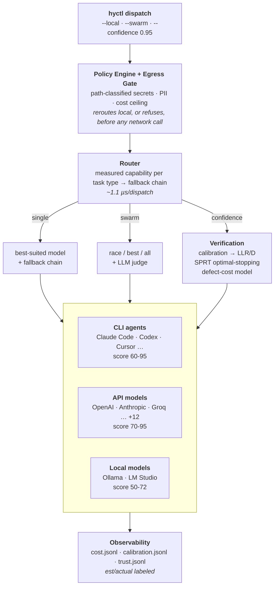

<div align="center">

<pre>
    ██╗  ██╗██╗   ██╗██████╗ ██████╗  █████╗ 
    ██║  ██║╚██╗ ██╔╝██╔══██╗██╔══██╗██╔══██╗
    ███████║ ╚████╔╝ ██║  ██║██████╔╝███████║
    ██╔══██║  ╚██╔╝  ██║  ██║██╔══██╗██╔══██║
    ██║  ██║   ██║   ██████╔╝██║  ██║██║  ██║
    ╚═╝  ╚═╝   ╚═╝   ╚═════╝ ╚═╝  ╚═╝╚═╝  ╚═╝
</pre>

### Picks the model best suited to each task, and can check the answer before you rely on it

*Any model, any provider. Hydra can check the answer, and ask another model when the check fails.*

[](LICENSE)
[](go.mod)
[](https://hydra.uvansa.com#platform-support)
[](https://github.com/ankit373/hydra/stargazers)
[](https://github.com/ankit373/hydra/issues)
[](CONTRIBUTING.md)

<br/>

[**Website**](https://hydra.uvansa.com) · [**Docs**](https://hydra.uvansa.com/docs) · [**Roadmap**](https://github.com/users/ankit373/projects/2) · [**Issues**](https://github.com/ankit373/hydra/issues)

</div>

---

## What is Hydra?

**Hydra picks the model best suited to each task, and can check the answer before you rely on it.**

You probably have access to several models: hosted APIs (OpenAI, Anthropic, Gemini, Bedrock, Mistral and others), local models through Ollama or llama.cpp, and CLI agents. Each is good at different kinds of work, and none of them tells you when its answer is wrong. Hydra sits in front of all of them. In RFC 0001's terms it is a *verified cascade gateway*:

- **It finds your models.** Hydra discovers API keys, local model servers and CLI agents on your machine, with no configuration.
- **It picks by measured record.** Each model is ranked on how often its answers have actually passed for that task type on your machine, starting from a catalogue score until it has a record. Today an unpinned request goes to the lowest-cost model measured competent at the task type, with stronger models behind it as the fallback chain.
- **It can check the answer.** Verifiers (tests, compile and lint for code; a grounding check against the prompt's own context; agreement between independent models) are evidence about the output. With `--confidence`, Hydra keeps asking until the answer's probability of being correct, P(correct), clears your target, then stops.
- **It keeps data where you say.** An egress gate refuses files like `.env` or `~/.aws/credentials` to any model that leaves your machine, and a local-only policy keeps sensitive work on your hardware.
- **It records what happened.** Every request is logged with the model that answered, token counts and cost.

Code is one task type among several, with its own verifiers. Summaries, extraction, drafting and review all go through the same router.

```bash
brew install ankit373/hydra/hyctl && hyctl init
```

> **Pure Go, single binary.** Hydra is one `hyctl` CLI. The legacy shell layer is gone. Everything below runs through `hyctl <command>`.

---

## Works With

Hydra discovers and routes to all of these automatically, with no plugins and no manual config:

**Coding Agents & CLIs**

| | | | | |
|:-:|:-:|:-:|:-:|:-:|
|  |  |  |  |  |
|  |  |  |  |  |

**API Providers**

| | | | | | |
|:-:|:-:|:-:|:-:|:-:|:-:|
|  |  |  |  |  |  |
|  |  |  |  |  |  |

**Local Runtimes**

| | |
|:-:|:-:|
|  |  |

---

## Architecture



Every executor is **native Go**: `agy`, Ollama, per-provider HTTP (OpenAI-compatible + Anthropic/Gemini/Cohere/Azure/Bedrock/Replicate), and generic CLI. No shell scripts in the hot path.

---

## By the Numbers

| Metric | Value | How it's measured |
|---|---|---|
| Routing overhead | **~1,130 ns / dispatch** | `go test -bench=BenchmarkRoutingPath` (Apple M1): policy eval + model selection + budget check |
| Machine discovery | **< 2 s** for 13+ CLIs, 14 API providers, 2 local runtimes | concurrent PATH + env + port scan (`hyctl probe`) |
| Calibration convergence | a 90%-reliable source → **D ≈ 1.76 nats** diagnostic power | `internal/trust` table tests; a coin-flip source → **D ≈ 0** (contributes nothing) |
| SPRT (easy tasks) | **2.6 samples, −49% vs fixed-5**, 98.8% accuracy | 20k seeded synthetic trials, `TestSPRT_Law3` |
| SPRT (blended workload) | **3.8 samples, −24% vs fixed-5**, 98.2% accuracy | same suite; 71% easy / 29% hard task mix |
| SPRT (hard tasks) | **6.8 samples** (adaptively *more* than 5), 96.7% accuracy | fixed-N ensembles can't do this; SPRT spends where accuracy demands it |
| Optimal parallelism | **6 agents** for independent work → **2** for same-subgraph edits | `n* = √((1−s)/k)`, Law 4; `k` from graph coupling (`internal/optimal`) |
| Context signal density | useful tokens = `length × ρ`; a dense 100k window beats a noisy 1M | Law 5; ρ via gzip-ratio proxy (`internal/entropy`); compact on falling ρ |
| Output capture | bounded at **33 MB** per subprocess | `internal/util.Accumulator`, no unbounded buffers |

> **Methodology & honesty.** Routing overhead, discovery, calibration, and SPRT figures are **measured**: reproduce the SPRT numbers yourself with `hyctl trust benchmark` (deterministic for a fixed seed; race-clean in CI). The SPRT numbers come from *synthetic* trials with known ground truth, not production traffic. They validate the algorithm (Wald sequential test), and land above the continuous theoretical `E[N]` (easy 1.33 / blended 2.48) because real evidence arrives in discrete steps. Hydra publishes no savings percentage, because cost depends on your models and your work; `hyctl stats` reports your actual spend. As production `trust.jsonl` accumulates, `hyctl trust stats` graduates these from *modeled* to *observed*.

---

## The Math

Hydra's routing decisions are not heuristics with a confident tone. Each one is a named result you can check. Every equation below is either a **theorem we apply** or a **quantity we measure**, tagged so you always know which:

> ⊢ **proven**: an established theorem · ▣ **measured**: computed in-repo, reproducible · ◈ **synthetic**: seeded benchmark, known ground truth · ○ **modeled**: an estimate or proxy

### 1 · Confidence routing: Wald's Sequential Probability Ratio Test

Instead of always polling a fixed number of models, Hydra accumulates the log-likelihood ratio across votes $x_1,\dots,x_n$ and stops the instant the evidence is conclusive:

$$\Lambda_n = \sum_{i=1}^{n} \ln \frac{P(x_i \mid \text{correct})}{P(x_i \mid \text{incorrect})}, \qquad \text{accept if } \Lambda_n \ge A,\ \ \text{reject if } \Lambda_n \le B$$

$$A = \ln\frac{1-\beta}{\alpha}, \qquad B = \ln\frac{\beta}{1-\alpha}$$

for target error rates $\alpha,\beta$. Wald proved this minimizes the **expected number of samples** $E[N]$ among *all* tests with the same error bounds.

*Analogy: a doctor ordering one test at a time and stopping the moment the diagnosis is certain, instead of always running the full panel.*
⊢ Wald (1945), optimality proven · ◈ −24% (blended) / −49% (easy) samples vs fixed-5 at ≥98% accuracy, reproducible with `hyctl trust benchmark` · source: [`internal/trust`](internal/trust)

### 2 · Calibration: diagnostic power `D`

Every source (model or verifier) earns a sensitivity $se=P(\text{says correct}\mid\text{correct})$ and specificity $sp=P(\text{says incorrect}\mid\text{incorrect})$ from real outcomes (a Beta-Bernoulli posterior). A single vote is worth an LLR of $\ln\frac{se}{1-sp}$ (a "correct" vote) or $\ln\frac{1-se}{sp}$ (an "incorrect" vote). Its **diagnostic power** is the expected evidence per vote, the KL divergence between the vote distributions under the two hypotheses, in nats:

$$D = se\,\ln\frac{se}{1-sp} + (1-se)\,\ln\frac{1-se}{sp}$$

A perfectly reliable source has large $D$; a coin-flip source ($se=sp=0.5$) has $D=0$ and contributes nothing no matter how often it votes. A 90%-reliable source gives $D\approx 1.76$ nats.

*Analogy: a witness's credibility, measured in nats. A coin-flip witness tells you nothing however many times they testify.*
⊢ information theory (KL divergence) · ▣ measured: the 90% → 1.76-nat figure is a table test in [`internal/trust`](internal/trust)

### 3 · When to stop: the defect-cost bar

Confidence isn't free and defects aren't equal, so the required bar is a Bayes-risk decision. The expected loss of shipping an answer believed correct with confidence $c$ is $(1-c)\,C_{\text{defect}}$; ship only when that clears a loss tolerance $\tau$:

$$c^\star = 1 - \frac{\tau}{C_{\text{defect}}}$$

A costlier defect ⟹ a higher confidence bar ⟹ SPRT samples more before it stops. Blast radius (§4) feeds $C_{\text{defect}}$.

*Analogy: you demand far more certainty before heart surgery than before a haircut.*
⊢ Bayes decision theory · ○ $C_{\text{defect}}$ is a modeled estimate (`hyctl trust defect`) · source: [`internal/trust`](internal/trust)

### 4 · Blast radius: Molloy-Reed percolation

Treat the code as a graph with degree mean $\langle k\rangle$ and second moment $\langle k^2\rangle$. A **giant connected component**, a cascade-capable core where one change can ripple everywhere, exists precisely when the Molloy-Reed criterion holds:

$$\kappa = \frac{\langle k^2 \rangle}{\langle k \rangle} \ge 2$$

Files inside a high-$\kappa$ core get their confidence bar raised: an edit to a hub everything imports must be far surer than an edit to a leaf helper.

*Analogy: the epidemic threshold $R_0$. Below it a change stays local; above it, one edit can infect the whole graph.*
⊢ Molloy-Reed (1995), proven · ▣ computed from `graph.json` in [`internal/graph`](internal/graph), see `hyctl graph blast`

### 5 · Optimal parallelism: Amdahl + coordination

Fanning work across $n$ agents speeds the parallel part but adds coordination cost that grows with $n$. With serial fraction $s$ and per-agent coupling $k$, wall-clock time is

$$T(n) = s + \frac{1-s}{n} + k\,n \quad\xrightarrow{\ \frac{dT}{dn}=0\ }\quad n^\star = \sqrt{\frac{1-s}{k}}$$

Independent files (small $k$) → fan out to ~6 agents; tightly-coupled edits to the same subgraph (large $k$) → ~2. More is slower.

*Analogy: adding cooks to a kitchen. Past $n^\star$ they spend more time coordinating than cooking.*
⊢ Amdahl (1967) + coordination term · ▣ $k$ derived from graph coupling in [`internal/optimal`](internal/optimal), see `hyctl graph parallel`

### 6 · Context governor: signal density, not length

A context window's value is its information density, not its token count. Hydra proxies the entropy rate with a compression ratio $\rho\in(0,1]$ and counts only the *useful* tokens:

$$\rho = \frac{\lvert \text{gzip}(C) \rvert}{\lvert C \rvert}, \qquad \text{useful tokens} = L \cdot \rho$$

Highly compressible context (repetitive, stale) has low $\rho$ and few useful tokens, so Hydra compacts on **falling $\rho$**, not on raw length. A dense 100k window beats a noisy 1M one.

*Analogy: signal-to-noise. A short, sharp briefing beats a rambling transcript ten times its length.*
⊢ Shannon source-coding (entropy rate) · ○ gzip is a proxy, not a proof; it is a heuristic · source: [`internal/entropy`](internal/entropy) · see `hyctl context entropy`

> **See it move.** The [**First Principles** page](https://hydra.uvansa.com/first-principles.html) has the interactive derivations: the SPRT log-odds walk hitting its boundaries, the percolation phase transition at $\kappa=2$, the Amdahl curve with its $n^\star$ marker, and the KL overlap that *is* `D`.

---

## Features

### 🔍 Zero-Config Discovery

Hydra scans your machine in under two seconds. No config files to edit, no plugins to install.

```
$ hyctl probe

  Heads discovered (6)                           2.1s

  › claude              Claude Code         score:95  cli    ✓ ready
    codex               OpenAI Codex        score:88  cli    ✓ ready
    openai              OpenAI (API)        score:88  env    ✓ key found
    ollama/qwen3:8b     Qwen3 8B            score:66  port   ✓ running
    ollama/phi4-mini    Phi-4 Mini          score:64  port   ✓ running
    anthropic           Anthropic (API)     score:95  env    ✓ key found
```

The score each model is listed under is the one it was **ranked** on: the catalogue's
number updated by what that model has actually got right on this machine, drawn from the
same calibration record `hyctl trust calibration` reports. A model that keeps being wrong
sinks below one the catalogue rates higher, and where that happened the table says what it
was adjusted from and on how many judged answers:

```
  Head                        Quant     Score  Declared      Src    Provider
  ──────────────────────────────────────────────────────────────────────────
  Qwen2.5-Coder:7b (Ollama)   Q4_K_M    38     66 (n=30)     port   local
```

Below twenty judged answers nothing moves at all, so a fresh install ranks exactly as it
always did. There is no per-quantization penalty table: a 2-bit model is outranked once it
has been measured, never because a hardcoded number said it should be.

A dispatch that knows its task type goes further and ranks on what each model got right at
**that kind of work**, so a model strong at Go and weak at SQL stops being routed both as
though it were one model:

```
$ hyctl dispatch --dry-run --enum EXPERT --domain ts "add pagination"
  Primary  →  Claude Sonnet 4.6 (Thinking)  (score 88, registry)  → 93 on 40 judged, 40 in ts

$ hyctl dispatch --dry-run --enum EXPERT --domain rust "add pagination"
  Primary  →  OpenAI Codex  (score 88, cli)  → 92 on 40 judged, 0 in rust
```

`--file foo.go` derives the same task type, so no flag is needed. Evidence from a model's other
task types still counts, since one thin in a task type should borrow from its own record rather
than be judged on three runs, but only up to a bound: without one, a model measured
everywhere *except* here outranked a model measured here, and naming a task type changed
nothing. The `0 in rust` above is that borrowing being honest about itself.

Scanning happens across three channels simultaneously:

| Channel | What it finds |
|---------|---------------|
| **PATH scan** | 13+ CLI tools: Claude Code, Codex, Cursor, Kiro, Windsurf, Gemini, Copilot, Cody, Amp, Continue, Ollama binary |
| **Port scan** | Ollama (11434), LM Studio (1234), LiteLLM (4000), llama.cpp (8080); queries each server and lists every installed model individually. Relocate one with `OLLAMA_HOST`, `HYDRA_LMSTUDIO_HOST`, `LITELLM_PROXY_URL` or `LLAMA_ARG_HOST`/`LLAMA_ARG_PORT` |
| **Env vars** | 14 API providers: Anthropic, OpenAI, Google, xAI, Groq, Together, Fireworks, Mistral, DeepSeek, Bedrock, Azure, Perplexity, Cohere, Replicate |

### 📥 Get a Model Without Leaving hyctl

```
$ hyctl models pull hf.co/Qwen/Qwen2.5-0.5B-Instruct-GGUF
  pulling 74a4da8c9fdb  491.4 MB / 491.4 MB (100%)
  ✓ pulled hf.co/Qwen/Qwen2.5-0.5B-Instruct-GGUF
    routable as ollama/hf.co/Qwen/Qwen2.5-0.5B-Instruct-GGUF:latest
```

The ref is whatever your local server resolves: an Ollama library name
(`qwen3:8b`) or a **HuggingFace GGUF repo**. The model id is read back from the
server rather than guessed, because Ollama renames a HuggingFace ref.

A model bigger than your machine can run is refused from the size the server
reports on the first chunk, seconds in rather than an hour later:

```
$ hyctl models pull hf.co/unsloth/Llama-3.3-70B-Instruct-GGUF
Error: model is larger than this machine can run: 42.5 GB to download against 3.0 GB usable.
  Pick a smaller quantization (Q4_K_M rather than Q8_0 or F16), or pass --force if this
  machine has more headroom than it reports
```

This is the only command that downloads weights, and nothing does it as a side
effect of anything else.

### 🧠 Hardware-Aware Local Model Selection

When you have Ollama, Hydra picks the best model for your actual available memory, not your total RAM. It reads 7 days of memory usage history and uses the 75th-percentile free memory reading so the recommendation reflects how your machine actually runs under typical load, not a lucky snapshot.

```
  Detected: Apple Silicon · 16GB total · memory fully occupied (1.2GB free)
  ⚠  Memory tight, close other apps to run local models

  Recommended alternatives (free tiers available):

  ✓ Claude Code   Free tier via claude.ai, npm install -g @anthropic-ai/claude-code
  ✓ OpenAI Codex  Free tier, npm install -g @openai/codex
  ✓ Cursor        Free tier IDE, cursor.com
```

```
  Detected: Apple Silicon · 32GB total · 18.4GB free for models
  Based on 14 samples over 6 days · typical free: 17.8GB avg, 16.2GB p75

  ✓ Qwen2.5-Coder 32B   32B   uses ~20GB · 0.4GB left (very tight)
  ✓ Qwen3 14B           14B   uses ~10GB · 6.2GB left free
  ✓ Qwen2.5-Coder 14B   14B   uses ~10GB · 6.2GB left free
  ✓ Qwen3 8B             8B   uses ~6GB  · 10.2GB left free  ← recommended
  ✓ Qwen2.5-Coder 7B     7B   uses ~5GB  · 11.2GB left free
```

### 🔒 PII-Aware Routing

Enable local-only policy in `hyctl init` and a prompt matching a PII detector is routed to a local model rather than a network one, at the dispatch layer, before any API call is made.

Detected patterns: Social Security Numbers, credit card numbers, phone numbers, IBANs, email addresses, API keys and tokens, IP addresses, private key material.

**What this is not.** Detection is a denylist over the prompt string, so it can only stop what somebody wrote a pattern for. That is why the egress gate below classifies by path instead, and why `hyctl security` withholds its coverage score entirely while the access policy still defaults to allow.

Coverage is measured rather than claimed. Against the [presidio-research][pr] synthetic set, some detector fires on 18.7% of the 1,387 texts that carry PII: 100% of emails, SSNs and IBANs, 93% of cards and IP addresses, and 69% of phone numbers. The gap is names, street addresses and organisations, 1,509 spans with no pattern to write, which is what a trained NER model exists for. Phone numbers are recognised by a country code, a parenthesised area code, the 3-3-4 grouping or a trunk zero; a bare run of digits is refused for the same reason nine bare digits are not read as an SSN. Re-run the figures with `go test ./internal/policy -run TestPII_Recall -v`.

[pr]: https://github.com/microsoft/presidio-research

`hyctl policy ner --head <id>` measures whether a model can read the half no pattern reaches. It asks 470 labelled texts and reports recall and false positives separately, because each alone is trivially passed. Measured on this machine, a 7B scored 0.87 recall at 0.00 false positives, while a 0.5B scored 0.86 recall and said yes to **94%** of the negatives: it clears a recall bar by answering yes to nearly everything, which is exactly why one number cannot decide this. Both are judged on the 95% interval rather than the point estimate, so a model is eligible only when the sample is large enough to say so. Decoding is pinned greedy, or the same model measures differently every run. An answer that is neither yes nor no is counted apart and never read as a no. **Nothing routes on this yet**, by design: it is the measurement that would earn it.

```bash
$ hyctl dispatch "process payment for card 4111-1111-1111-1111"

  Policy violation: prompt contains PII (credit card pattern)
  Action: routing to local-only head

  Dispatching → ollama/qwen3:8b  [local, no API call made]
```

### 🚪 Egress Gate

A detector can only stop what somebody wrote a pattern for. The egress gate classifies a file by **where it is**, not what is inside it, which closes a whole category whether or not its contents look like anything:

```bash
$ hyctl edit deploy/.env "rotate the database password"

  🔒 secret content (deploy/.env), routing to a local head only
  Dispatching → ollama/qwen3:8b  [local, nothing left this machine]
```

With no local model running, the default refuses rather than falling back to one that reaches the network:

```
no dispatchable heads: content classified secret (deploy/.env) and no local head
is routable. Start one (`ollama serve`), or set egress.strict = false in
config.toml to allow it out
```

The rules live in `registry/sensitivity.yaml`, embedded in the binary and overridable at `$HYDRA_HOME/registry/sensitivity.yaml` without a rebuild. They cover env files, private keys, cloud and cluster credentials, tfstate, SSH and package-manager config, and `~/.hydra` itself, with an `allow` list so a committed `.env.example` is not treated as a secret. Turn the floor off with:

```toml
[egress]
  strict = false   # default true; a config with no [egress] section is strict
```

**What it guarantees.** No file matching a rule reaches a model that leaves the machine, errors deny rather than allow, and a payload that declares no provenance is refused, so a new code path that forgets the gate breaks loudly instead of leaking quietly. Every decision is recorded in the ledger with the rule that produced it.

**Where the boundary is.** CLI agents are agents in their own right with their own filesystem access. Hydra guarantees what *it* sends; it cannot control what `agy` or `codex` independently decides to read once handed a task. The guarantee is total only when the work runs on a local model, which is exactly what the gate reroutes to.

**What it records.** Every dispatch writes its provenance to the ledger: what the payload was assembled from, how it classified, and whether the model it reached leaves the machine. That is what `hyctl security trifecta` reads:

```
  LETHAL TRIFECTA  2 dispatch(es) had all three legs and were not stopped
  over 7 dispatch(es) with recorded provenance

  private data         4 dispatch(es), read local files or environment
      deploy/.env                                  2
      internal/auth/token.go                       2
  untrusted content    4 dispatch(es), ingested content Hydra did not author
      head                                         4
  external comms       6 dispatch(es), reached a head that leaves the machine
      openai/gpt-5                                 5
```

Any one of the three is fine; all three at once is what turns a poisoned input into exfiltration with no software vulnerability involved. The headline is **exposure**, not presence: a trifecta the gate refused is reported as contained, because a dashboard that flags a working control teaches people to ignore it.

### 🧱 Least-privilege agents

Every subprocess Hydra spawns used to inherit your whole environment, so an `agy` subprocess held `AWS_SECRET_ACCESS_KEY`, every other provider's API key, and `SSH_AUTH_SOCK` for the duration of the call. Now an agent subprocess gets the base set (PATH, HOME, locale, proxy), **its own provider's credential**, and its own tool configuration. Nothing else crosses.

The allowlist cannot be complete, since every CLI agent reads its own settings and they change. If a model needs a variable Hydra does not know about:

```bash
export HYDRA_HEAD_ENV=SOME_AGENT_TOKEN,SOME_OTHER_VAR
```

Model subprocesses are also bounded so a grandchild holding the pipe open cannot hang a call on a process that already exited.

One related fix ships with it: local model weights are fingerprinted by digest alongside agent binaries, so a swapped model behind a familiar name is detected the same way a replaced agent binary is, which matters because Ollama pulls unsigned weights from a public registry.

**Not included.** Repo-supplied validator and oracle commands still run unconfined. Go's `os/exec` has no per-child rlimit support, and faking one through `sh -c 'ulimit ...'` would re-tokenize argv, which `internal/oracle` deliberately avoids. Real containment there needs a platform sandbox (`sandbox-exec`, seccomp) and is tracked separately.

**Scoping the agents themselves.** That covers what a model *holds*. What an agent may *reach* is the access policy at `~/.hydra/mcp_policy.json`, and Hydra ships no scoping rules there on purpose: which agent may write where is a decision about your repository, and a blanket deny gets uninstalled rather than tuned. `hyctl security` tells you who is running unscoped:

```
  Least privilege   3 agent(s) unscoped
    no policy rule names these agents, so they run under the default while
    changing state: hydra-swarm (720 state-changing), hydra-dispatch (127)
```

A rule narrows by agent, resource, action, or any combination. First match wins, so put the specific rules above the general ones:

```json
{
  "default": "allow",
  "rules": [
    {"agent": "hydra-swarm", "resource": "registry/**", "action": "write",
     "decision": "deny", "framework": "owasp:llm03"},
    {"agent": "hydra-swarm", "resource": "**/*_test.go", "action": "write",
     "decision": "ask"},
    {"classification": "mcp-quarantined", "decision": "deny"}
  ]
}
```

`deny` refuses and records it. `ask` parks the task under `hyctl ask` instead, which is the right verdict when you want a human in the loop rather than a refusal; it stops dispatch before any executor runs and never falls through to a cheaper model. `hyctl mcp check` exits 3 on a deny and 4 on an ask, so a script can tell a refusal from a question, and 0 only ever means the access was allowed. Check a rule fires before trusting it, then read back what the policy is actually doing:

```bash
hyctl mcp check fs --agent hydra-swarm --resource registry/routing.yaml --action write
hyctl security --why     # per-rule hit counts, rules that never matched, rules unreachable
```

A rule that has never matched is reported as such, and one an earlier rule always shadows is reported as unreachable, so a policy that reads strict and does nothing shows up as exactly that.

### 💰 Full Cost Visibility

Every dispatch is logged to `~/.hydra/cost.jsonl` with model, routing level, token counts, estimated cost, and fallback chain. Costs are **honestly labeled**: `tokens_source` marks whether a provider reported real usage or Hydra estimated it, and `cost_source` is always `estimated` (pricing × tokens, never a billed figure). Run `hyctl cost` or `hyctl stats` to see where your budget is going, or `hyctl stats --latency` for p50/p90/p99 per model, computed from mergeable sketches accurate to within 1%, so percentiles survive even after the raw rows are gone. Each row also carries `act_prob` (the probability the router picked that model) and `keep_prob` (the probability the row was kept), so a sampled log can still be read without bias. Averaging a non-uniformly sampled log understates rates badly enough to reverse which model looks better.

```
$ hyctl cost

  Cost, last 30 days

  Model                 Dispatches   Tokens       Est. Cost
  claude                12           48,200        $0.72
  openai                4            12,100        $0.18
  ollama/qwen3:8b       89           341,000       $0.00  (local, free)
  ─────────────────────────────────────────────────────────
  Total                 105          401,300       $0.90
```

### ⚡ Routing levels with automatic fallbacks

Every model is placed on a routing level by capability score, and `--enum` or `--tier` can pin a request to one. If a model is unavailable, Hydra falls back automatically.

| Routing level | Score range | Example models |
|------|-------------|---------------|
| `expert` | 90-100 | Claude Code, Claude Opus |
| `complex` | 80-89 | Codex, GPT-4.1, Gemini Pro |
| `standard` | 70-79 | Gemini Flash, Claude Haiku |
| `simple` | 60-69 | Qwen3 8B, Qwen2.5-Coder 7B (local) |
| `local` | 50-59 | Llama 3.2 3B, Phi-4 Mini |

```bash
# Let Hydra pick the best available model
hyctl dispatch "refactor auth middleware to use JWT refresh tokens"

# Preview the full fallback chain before dispatching
hyctl dispatch --dry-run "write a SQL migration"
#
#   Primary:   claude (score: 95)
#   Fallback:  codex  (score: 88)  ← if claude unavailable
#   Fallback:  openai (score: 88)  ← if codex unavailable
#   Local:     ollama/qwen3:8b     ← always available

# Force local: no API calls regardless of policy
hyctl dispatch --local "write unit tests for this function"
```

### 📺 Output as It Arrives

A dispatch renders while the model writes it, on every surface: the CLI, the `hyctl tui` cockpit,
the desktop app, and a swarm fan-out. Seven executor paths stream natively, the OpenAI-compatible
wire shape (and Azure, which shares it), Anthropic, Gemini, Cohere, Bedrock over its binary event
stream, Ollama, and the agy CLI. Replicate is the one that does not: its prediction API polls, so
there is nothing to read incrementally.

A model that cannot stream is not a second code path. `executor.Stream` delivers its whole output as
one delta, so a surface is written once and the two kinds cannot drift apart in how they render.

When the router falls back mid-answer, the abandoned partial does not stay on screen pretending to
be the answer. It collapses to one line naming the model, roughly how much it wrote and why it
stopped, and expands if you want to read it:

```
⤺ abandoned  openrouter/gpt after ~212 chars: 429 rate limited
    hyctl trace view run-7f2a --span 9c1d4e02
```

That command is only offered when payload capture is on. Without it the span exists but stores no
text, and pointing you at an empty page would be worse than saying nothing.

### 🐝 Swarm Dispatch

Fan a single prompt out to multiple models at once, then keep the best answer:

```bash
hyctl dispatch --swarm --swarm-mode race "prompt"   # first success wins (latency)
hyctl dispatch --swarm --swarm-mode best "prompt"   # LLM judge picks the best answer
hyctl dispatch --swarm --swarm-mode all  "prompt"   # every answer, ranked by CapScore
```

`--swarm-max-heads`, `--swarm-max-cost` (pre-flight cost guard), and `--swarm-heads id1,id2` give you fine control over fan-out.

### 🛡️ Security Posture (`hyctl security`)

Every access an agent makes is already recorded in the local MCP ledger, hash-chained
and anchored. `hyctl security` reads that log and answers the question you actually
have:

```
  VERDICT  ACT NOW
    critical incident, gpt-4o: the same resource was denied repeatedly, then it
    escalated to an exec/network action, then it targeted the audit trail itself.
    recon → escalation → audit-tampering · 4 event(s) · likelihood 8 × impact 8

  activity  4 blocked · 0 flagged
  evidence  4 event(s), 4 hash-chained, intact
```

Counts hide the sequence. "4 denied, 2 flagged" and "injection → recon → escalation →
an attempt on the audit trail" are the same rows read twice; only the second is an
incident. Severity is OWASP Risk Rating (likelihood × impact), never a blended score.

`--why` opens the full programme underneath: a risk register with an SLA clock and a
curated crosswalk to OWASP LLM / NIST AI RMF / ISO 42001 / MITRE ATLAS / SOC 2, OWASP
LLM Top-10 coverage, a policy audit that finds rules which can never fire, PII exposure
resolved against real models, control-effectiveness (a control that is configured but
never applied is reported as **inert**, not as protection), agent-binary integrity, and
edit blast radius. `--attest` emits a checkable attestation that states plainly when
the underlying log is not tamper-evident, rather than blessing it.

Deliberately honest about its own limits: framework mappings are marked **curated**
assertions rather than measurements, defect cost is **per-occurrence and not
annualised**, a file the dependency graph does not index is **unknown** and never
"low-risk", and the attestation is **unsigned** because Hydra has no key management.

**The servers it routes to are checked, not taken on trust.** Hydra discovers local model
servers, ranks them and sends real work to them, so their configuration is part of its own
posture. Two checks say so rather than assuming it:

```
Local server exposure      1 exposed
  ollama 0.9.9 (http://localhost:11435) answers on 192.168.1.15. That address is not
  loopback, so the server is serving more than this machine, and neither Ollama nor
  vLLM requires authentication by default

Local server advisories    9 unfixed upstream
  no upgrade answers these, so the mitigation is not reaching them: CVE-2024-12055,
  CVE-2024-8063, CVE-2025-0312, and 6 more
```

Ollama ships with no authentication and prints no warning when bound to `0.0.0.0`, and a
model server reachable from the network is the one thing that falsifies local-first outright.
The probe compares the same identity endpoint discovery already uses, between loopback and
this machine's own addresses, so nothing goes on the wire and an unrelated listener on the
same port is not mistaken for the model server.

`--advisories` asks OSV about the versions found, and is off by default because it is the only
part of the report that leaves the machine. Advisories **with** a fix are separated from
advisories **without** one: upgrading answers the first and cannot answer the second, and a
fully current Ollama carries nine of the second kind, so a single count would read the same on
a patched server as on an abandoned one. Both checks state what a negative result does not
prove: a host firewall that drops the probe is indistinguishable from a server that is not
listening, and a lookup that failed is unchecked rather than clean.

**Its own state directory is checked too.** The report has always said the agent-binary
baseline is forgeable by anything that can write `~/.hydra`, and nothing checked whether
anything can:

```
State directory reach      3 readable by others
  /Users/you/.hydra is 0755; /Users/you/.hydra/logs is 0755 ... The files themselves
  are not readable, so this leaks the listing rather than the contents
```

Writable is the finding, because `head_binaries.json` is the record that says no model
binary changed and `mcp_ledger.jsonl.chainhash` is the anchor that says nothing was
removed from the ledger, and both are plain files. Readable is reported separately and
more quietly, since it exposes the listing rather than the contents. `hyctl security`
never changes a permission: it is a read, and a command that silently chmods your
directory while you asked it a question is a surprise.

**The boundary the numbers cannot state.** A CLI agent (claude, agy, codex,
cursor) is itself an agent, with its own filesystem and network access, in a process
Hydra does not control. Everything scored above is what Hydra *sends and records*;
what such a model independently reads and ships is outside it. Only a local-only run
keeps the whole task on this machine. The default view says so in words, because no
coverage percentage can.

Scored against the **2026** edition (`OWASP-GenAI-LLM-Top-10-2026-v1.0`, published
4 August 2026). Seven of the ten moved: Excessive Agency rose 06 to 03, Improper
Output Handling fell 05 to 10, and System Prompt Leakage was replaced by the broader
LLM08 Hidden Context Exposure.

Category IDs are qualified by their OWASP **edition**, in `--json`, in `--csv` and on
every persisted score entry. Only LLM01 and LLM02 keep their number between editions,
so gap age is never computed across two of them: a reordering restarts that clock
rather than reporting one category's history under another's name. Upgrading to a
build that changes edition therefore resets every gap age to zero once, by design;
the alternative is dating one category's history under another's name.

**Two taxonomies, because they answer different questions.** The OWASP LLM Top 10 governs what a model *says*. The [OWASP Top 10 for Agentic Applications](https://genai.owasp.org/resource/owasp-top-10-for-agentic-applications-for-2026/) (ASI01-ASI10) governs what a system *does*, and an orchestrator with fallback chains, swarm fan-out, tool access and cross-run memory is squarely the second. Both are scored, side by side:

```
  OWASP Agentic Top-10 coverage  50%  (5/10, 4 partial)
  ────────────────────────────────────────────────
    ASI01  Agent Goal Hijack                partial
    ASI02  Tool Misuse and Exploitation     configured
    ASI03  Identity and Privilege Abuse     enforced
    ASI04  Agentic Supply Chain             configured
    ASI05  Unexpected Code Execution        partial
    ASI06  Memory and Context Poisoning     partial
    ASI07  Insecure Inter-Agent Communicat… partial
    ASI08  Cascading Failures               gap
    ASI09  Human-Agent Trust Exploitation   configured
    ASI10  Rogue Agents                     configured
```

Every status is read from live state, not asserted. `ASI02` tracks the policy default, so a fail-open policy reports `partial` and an absent one reports `gap`. `ASI08` reports `gap` without a `graph.json`, because blast radius you cannot compute is not blast radius you have bounded. `ASI10` drops to `gap` the moment the ledger chain breaks, since the record that would show an agent acting outside policy is precisely the thing that just became untrustworthy. And `partial` never counts toward the percentage.

### 🧩 MCP server safety registry (`hyctl mcp registry`)

The ledger above records what an agent *did*. This scores whether the MCP server it
was talking to was ever safe to trust in the first place. Every existing MCP directory
answers "does this server exist", none answer "is it safe to run with my credentials
right now," and star/download counts are actively misleading (the most-starred
servers score worst on quality in independent research).

```
hyctl mcp registry sync       # pull the official MCP registry into a local cache
hyctl mcp registry scan       # find servers installed across Claude Code/Desktop, Cursor, Windsurf, VS Code
hyctl mcp registry audit      # resolve + score them, advance lifecycle state, check tool descriptions
hyctl mcp registry backtest   # prove the pipeline still catches real incidents (postmark-mcp, CVE-2025-6514)
```

Only a *confirmed* finding (a known advisory match) quarantines a server, a name-similarity
heuristic lowers the score without condemning it, since quarantine has no automatic way out and
`clear` is the manual recovery path. A category that could not be checked contributes a neutral
baseline rather than dropping out of the average, so failing to reach GitHub can never *raise* a
score, and a server nothing is known about reads "insufficient evidence" instead of a number.

Scoring follows the CSA MCP Selection Scorecard's four categories, automating a
taxonomy the MCP Security Working Group already endorsed, not inventing a competing
one. Every version bump drops a server's status back to **provisional** until it
re-earns it, detected via a content-hash diff of the manifest, the direct fix for a
server that ships clean for months, then turns malicious in one release. A server can
also keep its version and rewrite what its tools say, so each tool's name, description
and input schema is hashed too, and any change is its own trip back to provisional, with
the before and after printed by `audit`. Descriptions are also checked for text written
for the model rather than the user (directions about other tools, requests to read files
or send data, hidden characters, padding), each reported with its exact span and never
quarantining on its own. Both need the server's `tools/list` result saved at
`$HYDRA_HOME/mcp_tools/<server>.json`: `audit` never starts a server to ask, and says
"not checked" for any server without one. `scan` never
reads env-var or secret values from client configs, only server identity. Feeds back
into the ledger: a flagged or quarantined server auto-classifies its own tool calls,
by the same mechanism that auto-detects PII from content, so a policy rule can gate on it
without any extra configuration.

### 🧭 Checking the answer: confidence routing

Most routers pick a model and hope. Hydra can check the answer: **verified correctness**. Instead of always firing a fixed number of models, `--confidence` runs a **sequential probability ratio test (SPRT)**: it samples models adaptively, in most-diagnostic-per-dollar order, and stops the moment the calibrated log-odds that the answer is correct cross your target P(correct).

```bash
hyctl dispatch --confidence 0.95 "is this migration safe to run in prod?"
```

**Calibration is a prerequisite, not a nice-to-have.** An uncalibrated source
has sensitivity = specificity = 0.5, so its verdict contributes `ln(0.5/0.5) = 0`
however emphatically it agrees. With no calibrated source for the task type the
estimate cannot move at all, so Hydra refuses the run rather than sampling every
model to arrive back at 50%, and tells you what does carry evidence:

```
$ hyctl dispatch --confidence 0.9 --domain go "is this safe?"
Error: no head this run would sample has been scored in domain "go", so
--confidence would sample every head, move the estimate nowhere and hand back 50%.

  Scored in "go":  verifier:go
  ...but none of them is among the heads this run selects.
  Other domains with evidence: gotest, trust-bench
  Record an outcome:     hyctl trust record --source <head-id> --domain go --said-correct --outcome correct
```

The distinction matters: a task type nothing has ever scored and a task type scored
only by a source this run would not sample need different fixes.

It leans on **per-source calibration** you build from real outcomes, each model/verifier earns a measured sensitivity, specificity, and *diagnostic power* `D`. A coin-flip source (`D≈0`) contributes nothing; a proven one lets a single vote go a long way.

Recording only your own answers is not enough to calibrate: a model that produced
an answer always "said correct", which fills TP and FP and leaves TN on its bare
prior, so specificity is never measured and `LLR = ln(se/(1-sp))` stays under
`ln 2 = 0.693` nats, against the `2.944` a 95% target needs. The dissenters are
what fix it. `hyctl trust outcome` replays a past ensemble run's ledger once its
answer is known, so a model that disagreed with an answer that turned out wrong
finally earns the true negative that specificity can only come from.

```bash
hyctl trust outcome <task_hash> --outcome incorrect   # train every source that voted in a run
hyctl trust record --source ollama/qwen3:4b --domain go --said-correct --outcome correct
hyctl trust calibration          # per-source se / sp / D table (neg=0 flags an unusable cell)
hyctl trust defect --pii --production   # modeled $ cost of shipping a wrong answer
hyctl trust stats                # samples saved vs fixed-N, achieved vs target confidence
hyctl trust explain <task_hash>  # the full LLR ledger for a past run: why it stopped
hyctl trust reliability          # is the stated confidence honest? Brier / ECE / diagram
```

Every confidence run ends by printing its own `task_hash` and the `trust explain`
command for it, so the ledger above is one copy-paste away rather than something
to go looking for. `trust stats` says outright when achieved confidence has never
left the 50% prior, which means the runs paid for models without learning
anything, rather than leaving that to be inferred from a savings figure.

**Blast-radius aware.** Point Hydra at a dependency graph (`graph.json` from [Graphify](https://github.com/safishamsi/graphify) or any tree-sitter indexer) and the confidence bar scales with how much code an edit could break, a fix to a hub everything imports demands far more certainty than a leaf helper:

```bash
hyctl graph blast internal/auth/token.go        # 3 transitive dependents → demands 96.7%
hyctl dispatch --confidence 0.90 --file internal/auth/token.go "rotate the signing key"
#   graph: blast radius 3.00 → demands confidence ≥ 96.7%  (raises the 0.90 floor)
```

In synthetic benchmarks this cuts model calls **~49% on easy tasks** and **~24% on a blended workload** at ≥98% accuracy, while deliberately sampling *more* than a fixed swarm on genuinely hard tasks, which a fixed-N ensemble cannot do.

> The SPRT ensemble, calibration engine, defect-cost model, graph-aware (blast-radius) routing, the local MCP accountability ledger, verification oracles, security posture assessment (`hyctl security`), and the native desktop app have all shipped. A browser-based Web UI and a central MCP server registry are on the [roadmap](#roadmap).

---

## Comparison

| | Hydra | Manual routing | LiteLLM | RouteLLM |
|---|:---:|:---:|:---:|:---:|
| Auto-discovers tools on your machine | ✅ | ❌ | ❌ | ❌ |
| Hardware-aware local model selection | ✅ | ❌ | ❌ | ❌ |
| PII detection + local enforcement | ✅ | ❌ | ❌ | ❌ |
| Fallback chains | ✅ | ❌ | ✅ | ✅ |
| Per-dispatch cost logging (est. vs actual labeled) | ✅ | ❌ | ✅ | ❌ |
| Works with CLI tools (not just APIs) | ✅ | ✅ | ❌ | ❌ |
| Zero config to start | ✅ | ✅ | ❌ | ❌ |
| Swarm dispatch (race / best / all) | ✅ | ❌ | ❌ | ❌ |
| Checks the answer to a target **P(correct)** (SPRT) | ✅ | ❌ | ❌ | ❌ |
| Per-source calibration (sensitivity / specificity / D) | ✅ | ❌ | ❌ | ❌ |
| MCP accountability ledger | ✅ | ❌ | ❌ | ❌ |
| Security posture + correlated incident detection (`hyctl security`) | ✅ | ❌ | ❌ | ❌ |
| Native desktop app (Models / Activity / Usage / Audit) | ✅ | ❌ | ❌ | ❌ |

---

## Getting Started

The CLI binary is **`hyctl`** (the product is Hydra). Pick whichever fits your stack, every method installs the same prebuilt binary and verifies its checksum.

**Homebrew** (macOS/Linux):
```bash
brew install ankit373/hydra/hyctl
```

**npm**: or run once with no install via **npx**:
```bash
npm install -g hyctl      # global install
npx hyctl init            # run without installing
```

**pip** (Python 3.8+):
```bash
pip install hyctl
```

**Standalone installer**: macOS/Linux (curl):
```bash
curl -fsSL https://raw.githubusercontent.com/ankit373/hydra/main/install.sh | sh
```

**Standalone installer**: Windows (PowerShell):
```powershell
irm https://raw.githubusercontent.com/ankit373/hydra/main/install.ps1 | iex
```
Installs per-user to `%LOCALAPPDATA%\Programs\hyctl` and extends your user `PATH`, with
no administrator rights needed. Both installers verify the download against the
release's `checksums.txt` and refuse to install if it is listed and does not match.
Pin a version with `$env:HYDRA_VERSION` / `HYDRA_VERSION`, or change the directory
with `$env:HYDRA_BIN` / `HYDRA_BIN`.

**Prebuilt binaries**: download from [github.com/ankit373/hydra/releases](https://github.com/ankit373/hydra/releases).

#### Platform support

Every release builds `hyctl` for all six targets below. This table is kept in step with
`.goreleaser.yaml`'s build matrix, if a row is here, an artifact exists for it.

| OS | x86-64 | ARM64 | Homebrew | npm / npx | pip | script |
|---|:--:|:--:|:--:|:--:|:--:|:--:|
| macOS | ✅ | ✅ (Apple Silicon) | ✅ | ✅ | ✅ | `install.sh` |
| Linux | ✅ | ✅ | ✅ | ✅ | ✅ | `install.sh` |
| Windows | ✅ | ✅ |, | ✅ | ✅ | `install.ps1` |

Windows has no Homebrew; use npm, pip, `install.ps1`, or download the archive directly.

The **desktop app** ships for macOS (universal), Windows x86-64/ARM64, and Linux x86-64/ARM64, five
targets total ([#263](https://github.com/ankit373/hydra/issues/263)), each built on a native runner
(including two hosted ARM runners) and uploaded on every RC and stable release. `install-app.sh`
resolves the right archive for your OS/arch automatically, nothing to configure per-arch.

**From source** (Go 1.26+):
```bash
git clone https://github.com/ankit373/hydra.git
cd hydra
go build -o hyctl ./cmd/hydra && mv hyctl /usr/local/bin/
```

> Not to be confused with the unrelated `hydra`/`hydra-cli` npm packages (pnxtech microservice libs) or homebrew-core's `hydra` (THC password cracker), this project's CLI is `hyctl`.

### First Run

```bash
hyctl init
```

The wizard scans your machine, ranks every model it finds, walks you through picking your main model, lets you choose a local Ollama model calibrated to your actual hardware, and asks whether you work with sensitive data that should never leave your machine. Takes about 60 seconds.

### Core Commands

```bash
# Discovery & state
hyctl init                              # first-run wizard
hyctl probe                             # scan and display all available models
hyctl status                            # live state: models that can run, budget bars, burn-rate risk
hyctl tui                               # interactive cockpit, six views (see below), `?` for shortcuts
hyctl version                           # version, commit, build info
hyctl upgrade                           # self-update via install.sh (curl installs only; brew installs: `brew upgrade hyctl`)

# Model registry (add a new model at runtime: no rebuild)
hyctl models list                       # known models, marked with what can actually route now
hyctl models add kimi-k3 --provider moonshot --cap-score 85   # record a score (not a model it can run)
hyctl models remove kimi-k3             # remove one of your additions
hyctl models sync                       # import the OpenRouter catalog (provisional scores)

# Dispatch
hyctl dispatch "..."           # route a prompt to the best model
hyctl dispatch --dry-run "..." # preview routing without executing
hyctl dispatch --local "..."   # local models only, no API calls
hyctl dispatch --swarm --swarm-mode best "..."   # fan out to many models, judge best
hyctl dispatch --confidence 0.95 "..."  # SPRT: sample until this P(correct) is reached

# Serve the router to anything that speaks OpenAI
hyctl serve                             # OpenAI-compatible endpoint, loopback only
#   the `model` field is the routing instruction: `hydra`, `hydra/hard`, `hydra/t4`, or a model id.
#   `hydra` takes --enum (STANDARD); --objective quality|cost or X-Hydra-Objective opts into routing by objective.
#   a class with [[serve.verifiers]] in config.toml (class, kind = "match", id, then a labels file or a pattern)
#   has each buffered answer on an objective route (opt-in) checked, and escalates to a model measured better in that class, at most --max-escalations (2).
#   streams as server-sent events, and passes tool calls through on every dialect it speaks.
hyctl serve --task-class classification.banking77   # class for requests that send no X-Hydra-Task-Class
#   X-Hydra-Task-Class routes on that class (and enables temperature); X-Hydra-Max-Cost-USD only lowers the ceiling.

# Tasks waiting on you
# A ledger policy can answer `ask` instead of allow or deny. Dispatch then stops
# before running anything and parks the task until you answer it.
hyctl ask list                          # what is waiting, and what it wants to know
hyctl ask answer <task-id> "go ahead"   # answer it and run the task
hyctl ask decline <task-id> "not prod"  # refuse it; nothing runs

# Cost & pricing
hyctl cost                              # spend summary (est. vs actual labeled)
hyctl stats                             # rollup by model / routing level / day
hyctl pricing list                      # live $/1M-token rates (OpenRouter + fallback)

# Calibration and verification
hyctl trust calibration                 # per-source sensitivity / specificity / D
hyctl trust record ...                  # feed one source's outcome to train calibration
hyctl trust outcome <task_hash> ...     # train every voter in a past run from its verified answer
hyctl trust defect ...                  # modeled cost of shipping a wrong answer
hyctl trust stats                       # samples saved, achieved vs target confidence
hyctl trust explain <task_hash>         # the LLR ledger for a past SPRT run
hyctl trust reliability                 # when it says 90%, is it right 90% of the time
hyctl edit --file /abs/path/f.go --enum SIMPLE --prompt "..."  # apply, then validate what was written: the verdict that counts
hyctl trust benchmark                   # measured SPRT numbers (samples saved, accuracy)
hyctl graph blast <file>                # a file's blast radius + the confidence it demands
hyctl graph parallel <files...>         # optimal number of parallel agents (Law 4)
hyctl context entropy <file|->          # signal density + useful tokens + compact hint

# Verification & accountability
hyctl oracle verify go test ./... --source verifier:go-test  # verifier as evidence + its LLR
hyctl eval stats                        # the verified corpus: size and pass rate by domain
hyctl eval readiness                    # per enum, whether the corpus can yet fit a routing choice
hyctl eval list --failed                # the examples the oracle rejected
hyctl eval training                     # vectors per embedding model, whether a classifier could be fitted
hyctl eval classify                     # does similarity to past work predict whether an enum passes
# A rule can then route on it: corpus.known / corpus.pass_rate / corpus.support in
# registry/signals.yaml, derived only when a rule names one. Alongside them,
# signals that need no model at all: language.script and (where the script
# decides it) language.code, structure.questions / .list_items / .code_fences /
# .ordered_steps, conversation.turns / .tool_loop, and context.prompt_tokens.

# The standalone verifier: fill the corpus with no router and no Hydra config.
# Ships in the same archive as hyctl, and reads no ~/.hydra at all.
hyverify --candidate internal/auth/token.go --task "rotate signing key" --enum MODERATE
hyverify --candidate out.go --task "..." -- go test ./...   # name the judge yourself
hyverify --candidate x.go --task "..." --embed-model nomic-embed-text  # so it trains a classifier
hyverify --version                                          # which build wrote a corpus row
hyctl mcp check <tool> --agent A --resource R --action write  # 0 allow, 3 deny, 4 ask
hyctl mcp check <tool> --content "$DATA" --action network      # PII auto-classified; policy can deny egress
hyctl mcp check <tool> --params '{"amount":500}'               # bind a hash of the params to the decision
hyctl mcp verify <tool> --resource R --params '{"amount":500}' # prove executed params == approved params
hyctl mcp verify-chain                  # confirm the ledger's hash chain hasn't been tampered with
hyctl mcp log --denied                  # what was withheld: denied and ask alike
hyctl mcp report                        # allowed/denied/ask by agent and tool
hyctl mcp registry sync                 # pull the official MCP registry into a local cache
hyctl mcp registry scan                 # list MCP servers installed on this machine (identity only)
hyctl mcp registry audit                # resolve + score installed servers, advance lifecycle state
hyctl mcp registry export --out DIR     # static index.html/index.json of audited servers
hyctl mcp registry backtest             # validate scoring against known real incidents
hyctl mcp registry list                 # audited servers by trust score
hyctl mcp registry clear <server>       # recover a server quarantined in error
hyctl security                          # what the agents did, and can the record be trusted
hyctl security --why                    # the full programme: register, coverage, policy, exposure
hyctl security trifecta                 # private data + untrusted content + egress: which dispatches had all three
hyctl security --advisories             # ask OSV about the local model server versions found
hyctl security --attest                 # checkable attestation: posture + evidence + digest

# Editing & batch
hyctl edit --file ... --enum ... --prompt "..."  # scoped, validated, rollback-safe file edit
hyctl review ...                        # code review / approve / reject / QA
hyctl parallel ...                      # fan independent tasks across models
hyctl workflow run --step A --step B    # multi-step task, each step routed on its own
hyctl workflow run --dry-run ...        # each step's routing chain and ceiling, nothing run
hyctl workflow run --local --max-cost 0.05 ...   # per-step caps, on top of policy.yaml's
hyctl workflow resume <id>              # continue a killed workflow from where it stopped
hyctl workflow show <id>                # each step's model, routing level, cost and output

# Reviewing a diff
hyctl vet                               # review the working diff, each file routed to its own model
hyctl vet --confidence 0.9              # sample each file with as many models as its blast radius warrants
hyctl vet --json                        # exits 3 on a blocking finding, so a script can gate on it
```

The corpus behind `hyctl eval` is the one thing Hydra keeps verbatim and forever, because it is the
only data a router can be improved against. It is your own code and prompts, so it stays in
`~/.hydra/evalset/`, nothing that prunes logs can reach it, and there is no upload path. A test
enforces that, rather than a comment promising it: no Hydra package that can reach the corpus
imports anything able to open a socket or exec, and the third-party packages it rests on are
pinned by name, so a new dependency is a decision rather than a side effect.

### The Cockpit (`hyctl tui`)

Six views, cycled with `tab` (or jump with `1-6`); `?` opens the shortcut glossary from anywhere:

| View | What it shows |
|---|---|
| **chat** | Type a task and it **executes**: a route line first (class → routing level → model · strategy · plain-words why, with a `local-only (pii)` badge and change impact when they apply), then the real answer or edit. `esc` cancels mid-run; failures link to their trace; session cost accrues in the header |
| **agents** | Live runs and today's finished ones, `enter` opens a run's trace |
| **models** | Every scanned model nested under its provider/server, with per-model detail: routing level, capability, p50 latency, requests/cost today, calibration scorecard. A down server grays its models; embedding-only models say `embeddings only, never routed` |
| **activity** | Today's runs with a full trace per run: routed → policy → request → stream → edits → done, fallbacks included |
| **usage** | Spend today / this month / estimated saving vs always using the most capable model, by model/routing level/day breakdowns, and the orchestrator's context budget |
| **audit** | Calibration scorecard, audit-log chain integrity, guardrails (PII local-only, injection markers, MCP server safety), and a needs-a-human queue |

Chat has **modes**: what a task does (`shift+tab` cycles the basics, `m` opens the full picker):

| Mode | What it does |
|---|---|
| **Ask** | Answer only, never writes files |
| **Edit** | Direct change when the prompt names an existing file (validated, rollback-safe, snapshotted); otherwise answers and says so |
| **Plan** | Drafts numbered steps on a cheap routing level and waits, `enter`/`y` runs them, `esc` discards |
| **Auto** | Plan → edit → **verify**: runs `go test ./...` (or your workspace.yaml validator) through the oracle, feeds failures back for up to 2 fixes, and renders a proof strip: `plan ✓ · edit ✓ file +A/−R · tests ✓/✗` |
| **Architect** | Auto, but plans on a strong routing level and implements on a cheap one |
| **Careful** | Auto, but every file write needs a `y/n` confirm before it lands |
| **Unattended** | Auto with no confirms and a hard $0.50 per-task cost cap, it stops visibly at the cap |

Where a task runs is separate: `ctrl+o` overrides the **next** task's routing (auto / force routing level / local only / best of 3 / consensus check at 90-99.9%). After an edit, type `/diff` for the diff, `/undo` to restore the pre-task snapshot exactly (it asks y/n first), `/open` to open the file; the footer's trace id jumps into the activity view. These are typed commands, not bare letters, so a message starting with `x` or `a` is just text.

Chat runs **parallel threads**: several tasks at once, safely:

| Key | What it does |
|---|---|
| `ctrl+t` | New thread (a chip strip appears under the header: `⠸` running · `●` needs you · `✓` done · `◱` queued) |
| `alt+1-9` | Jump to that thread; `ctrl+←/→` cycles them; the input bar labels its target (`→ thread 2`) |
| `ctrl+\` | Split: pin a second thread beside the active one (needs ≥100 cols); `ctrl+←/→` moves focus, each side scrolls on its own |
| `ctrl+b` | Background the thread into the **agents** view, it keeps running and pings chat (`hydra ▸`) when it finishes or needs you |
| `ctrl+g` | Jump to the next thread needing input (plan gates, confirms, failures); the status bar counts `⠸ running · ● needs you · ◱ queued` |
| `/apply` / `/undo` | Apply an isolated thread's worktree back to your tree / discard it (asks y/n, it deletes the thread's edits) |
| `ctrl+s` | Select mode: hand the mouse back to the terminal so you can select and copy text; again restores wheel scrolling |

**Isolation**: read-only work shares your checkout; each edit-capable thread gets its own git worktree (`~/.hydra/worktrees/tN-…`, branch `hydra/task-tN-…`) cut from your repo, the header shows `worktree tN-… · merges on apply`. `/apply` merges it back with standard git: clean applies stage the diff; a divergence leaves ordinary `<<<<<<<` conflict markers (the branch is kept until you resolve); and **unsaved** edits of your own to a file the thread touched block the merge before it starts, nothing half-lands, and work that exists only in your editor is never merged over. Two threads editing the same (or graph-coupled) files never race: the second queues visibly (`◱ queued behind 1 · both touch <path>`) and auto-starts when the first applies or discards. Outside a git repo the TUI says so and runs edits one at a time, in place. Worktrees left behind by a crash are listed at startup, never auto-deleted. Terminal note: `alt+1-9` needs the option/alt key sending ESC (iTerm2: "Esc+"; Terminal.app: "Use Option as Meta key"), and `ctrl+b` is tmux's default prefix, rebind tmux or press `ctrl+b ctrl+b`.

Everything shown is measured from the machine's real logs, a figure that cannot be computed renders `—`, never an invented number. Lists, overlays and the audit view all scroll (`j/k`, `↑/↓`, `pgup/pgdn`, mouse wheel), so nothing is reachable only by resizing the terminal; `hyctl tui --snapshot [--view 0..5]` prints static frames for docs and bug reports. Colours adapt to light and dark terminals (override the detection with `HYDRA_THEME=light|dark`), body text uses your terminal's own foreground, and under `NO_COLOR` the active tab still reads `[chat]`. Log output from background work goes to `~/.hydra/logs/tui.log` while the TUI owns the screen.

---

## Configuration

`~/.hydra/config.toml`, written by `hyctl init`, editable by hand:

```toml
cortex = "claude"
skills = ["code-gen", "review", "benchmark"]

[policies.pii]
action  = "local-only"
```

### Routing level names are enum names

`--tier` takes a number 1-10 or a name, and a name is just the lowercase of a
routing enum: `--tier simple`, `--enum SIMPLE` and `--tier 8` are one
instruction. `--tier local` is the one alias, a legacy name for `grunt`, the
free local floor. Retune any of them by editing `routing_map` in
`registry/routing.yaml` (or a copy at `$HYDRA_HOME/registry/routing.yaml`) and
both flags follow.

That holds on a fan-out too. `--enum` reached the swarm and stopped there, so
`--enum SIMPLE --swarm` fanned out over the top models by capability, which on a
machine with a frontier model is the most expensive five available and the exact
opposite of what SIMPLE asks for.

```bash
hyctl status            # every name, the routing level it resolves to, and what serves it
hyctl dispatch --dry-run --tier simple "add a DTO"
hyctl dispatch --dry-run --swarm --enum SIMPLE "add a DTO"   # the same models
```

Older configs carry a `[[tiers]]` block that assigned models to those names by
CapScore band. It is ignored, not rejected: the bands were a second routing
table and they disagreed with the enum about what every name meant, so
`--tier simple` billed a paid remote model where `--enum SIMPLE` ran a free
local one, or the reverse, depending on what `hyctl init` happened to discover.
Re-run `hyctl init` to drop the block.

### Routing between individual OpenRouter models

By default an `OPENROUTER_API_KEY` gives you one routing choice: a single model
(`OPENROUTER_MODEL`, or a built-in default). Hydra already prices and scores
OpenRouter's whole catalogue, so naming models turns each into its own routing choice
that the router can choose between on cost and capability:

```toml
[openrouter]
models = ["anthropic/claude-sonnet-4.5", "google/gemini-2.5-pro"]
```

`hyctl probe` then lists one entry per model and says how much of the catalogue
is enabled ("2 of 423"). A name the catalogue does not have is shown as not
routable with the reason, rather than quietly dropped. Naming nothing changes
nothing: the single key-derived model is exactly as before.

### Routing objective for `hyctl serve`

A `model: "hydra"` request routes as `--enum` (`STANDARD` by default). Routing
by objective is opt-in:

| Objective | Tries first | How to choose it |
|---|---|---|
| `quality` | the head measured strongest in the task class (often the priciest) | `hyctl serve --objective quality`, or `X-Hydra-Objective: quality` per request |
| `cost` | the cheapest head measured competent | `hyctl serve --objective cost`, or `X-Hydra-Objective: cost` |

A routed answer echoes `X-Hydra-Objective` and `X-Hydra-P-Pass-Basis`
(`measured`, `borrowed` or `catalogue_prior`). Under quota pressure the
governor routes it as `STANDARD`.

**Deprecated: the implicit default.** In v2.0.0 `quality` becomes the default
for `hydra`. Until then, a `hydra` request naming no objective, on a server
started with neither `--enum` nor `--objective`, still routes as `STANDARD`
but gets `Deprecation: @1794441600` (RFC 9745) and a `Link` to this section,
and the server prints one stderr warning per start
(`HYDRA_NO_DEPRECATION_WARNINGS=1` silences it). To keep today's route after
v2.0.0, send `model: "hydra/standard"` or start the server with an explicit
`--enum STANDARD`. To opt in now, use `--objective` or the header. Setting
policy.yaml `max_cost_usd` caps what `quality` may spend.

---

## Adding a Model

**At runtime, no rebuild.** Add any model to your local registry and Hydra picks it up on the next `probe`/`dispatch`. Additions live in an overlay at `~/.hydra/models.json` and merge over the built-ins:

```bash
hyctl models add kimi-k3 --name "Kimi K3" --provider moonshot --cap-score 85
hyctl models list                 # confirm it shows up, tagged "user"
hyctl models remove kimi-k3       # remove it (built-ins can be overridden, not removed)
```

**Built-in defaults** live in [`internal/capabilities/data.json`](internal/capabilities/data.json). To contribute a model as a shipped default, add one JSON entry, no Go code required:

```json
{
  "id": "your-model-id",
  "name": "Your Model Name",
  "provider": "your-provider",
  "capScore": 82
}
```

For Ollama models, add a family pattern:

```json
{
  "id": "family-prefix",
  "name": "Model Family Name",
  "provider": "ollama",
  "capScore": 70,
  "ollamaFamily": true
}
```

---

## Roadmap

| Feature | Status |
|---------|--------|
| Auto-discovery: CLI, API keys, local ports | ✅ Shipped |
| Hardware-aware Ollama model selection | ✅ Shipped |
| PII detection + local-only enforcement | ✅ Shipped |
| Routing by capability with automatic fallback chains | ✅ Shipped |
| First-run TUI wizard (`hyctl init`) | ✅ Shipped |
| `hyctl cost` / `hyctl stats`, spend breakdown, est. vs actual | ✅ Shipped |
| Dynamic live pricing (OpenRouter + 24h cache) | ✅ Shipped |
| Swarm dispatch, race / best / all + LLM judge | ✅ Shipped |
| **Per-source calibration** (Beta-Bernoulli → LLR / D) | ✅ Shipped |
| **Defect-cost model** (`hyctl trust defect`) | ✅ Shipped |
| **SPRT confidence routing** (`hyctl dispatch --confidence`) | ✅ Shipped |
| **Graph-aware routing**: blast-radius → defect cost → confidence | ✅ Shipped |
| **Optimal parallelism**: `n* = √((1−s)/k)` from graph coupling (Law 4) | ✅ Shipped |
| **Security posture** (`hyctl security`), verdict, correlated incidents, risk register | ✅ Shipped |
| **Causal A2A handoffs**: vector clocks, concurrent-edit conflict detection | ✅ Shipped |
| **Context-entropy governor**: compact on falling signal density, not length | ✅ Shipped |
| **MCP accountability ledger**: record + gate what every agent touches | ✅ Shipped |
| **Verification oracles**: tests/compile/lint as first-class evidence | ✅ Shipped |
| **Runtime model registry**: `hyctl models add` merges a `~/.hydra/models.json` overlay, no rebuild | ✅ Shipped |
| **Percolation-κ blast radius**: Molloy-Reed core detection weights hub files higher | ✅ Shipped |
| **Rate-aware budget governor**: first-passage-time risk on `claude_pct`, escalates before a threshold | ✅ Shipped |
| **Security posture** (`hyctl security`), verdict, correlated incidents, risk register, OWASP LLM Top-10 coverage | ✅ Shipped |
| **Native desktop app**: chat-first, with a pool-aware model picker and a routing pane; plus Models, Activity, Usage and Audit views | ✅ Shipped |
| MCP server registry, central connection/authorization plane across every MCP server | 📋 [#9](https://github.com/ankit373/hydra/issues/9) |
| Browser-based Web UI | 📋 [#12](https://github.com/ankit373/hydra/issues/12) |

See the full [Hydra Roadmap project board](https://github.com/users/ankit373/projects/2).

---

## Project Structure

```
hydra/
├── cmd/hydra/                   # CLI entry point (Cobra): every subcommand
├── internal/
│   ├── capabilities/            # Capability scoring: embedded data.json ⊕ runtime ~/.hydra/models.json overlay
│   ├── config/                  # TOML config at ~/.hydra/config.toml
│   ├── dispatch/                # Routing + fallback chains + policy + cost logging
│   ├── executor/                # Native executors: agy · Ollama · per-provider HTTP · CLI
│   ├── provider/                # Discovery providers (self-register via init())
│   │   ├── cli/                 # PATH scanner (13+ tools)
│   │   ├── env/                 # API key scanner (14 providers)
│   │   ├── port/                # Local server scanner (Ollama, LM Studio)
│   │   └── agy/                 # Antigravity tier registry
│   ├── probe/                   # Concurrent multi-provider discovery
│   ├── policy/                  # PII detection + local-only enforcement
│   ├── swarm/                   # Fan-out dispatch: race / best (LLM judge) / all + SPRT adapter
│   ├── trust/                   # Calibration · defect-cost · SPRT ensemble
│   ├── pricing/                 # Live cost DB (OpenRouter fetch + 24h cache + YAML fallback)
│   ├── cost/                    # cost.jsonl reader + spend summaries + source labeling
│   ├── ope/                     # Off-policy estimation + counterfactual policy evaluation with intervals
│   ├── otlp/                    # Dispatch log → OpenTelemetry spans (OTLP/HTTP, nothing sent by default)
│   ├── sketch/                  # Mergeable relative-error quantile sketch (bounded memory)
│   ├── embed/                   # Vectors from an embedding model already on the machine
│   ├── retrieve/                # Hybrid recall: BM25 ⊕ vectors, fused on rank, not on score
│   ├── rollup/                  # Per-day aggregates: calls, tokens, spend, latency sketch
│   ├── evalset/                 # Oracle-verified labelled examples: verbatim, never pruned, never uploaded
│   ├── budget/                  # Token-budget governor: 6 static pressure modes + rate-aware first-passage risk on claude_pct
│   ├── modelpull/               # Fetch a model into the local Ollama server (library or HuggingFace GGUF ref)
│   ├── rank/                    # Deduplication + ranking: CapScore updated by verified outcomes
│   ├── editor/                  # Scoped, validated, rollback-safe file edits
│   ├── parallel/                # Independent multi-task fan-out
│   ├── review/                  # Code review / approve / reject / QA
│   ├── util/                    # Shared utilities (bounded Accumulator, 33 MB cap)
│   ├── sysinfo/                 # Hardware detection + 7-day memory history
│   ├── payload/                 # Opt-in prompt/response store: chunked, packed, redacted,
│   │                            #   bounded by a byte budget that evicts oldest packs
│   ├── waterfall/               # A run as nested spans on a timeline, with each one's
│   │                            #   verdicts (hyctl trace view, hyctl trace score)
│   ├── runlog/                  # Per-run span log (~/.hydra/logs/runs/): identity, parent, level,
│   │                            #   tokens, TTFT, metadata + liveness heartbeat + edit snapshots
│   │                            # Old runs seal into compressed monthly segments (logs/seg/)
│   ├── tree/                    # Reconstructs a run: supervision tree + timeline, framework-free
│   ├── runid/                   # Run/task identity: correlates every log a run produces
│   ├── a2a/                     # Agent handoffs with vector clocks (causal ordering + conflict detection)
│   ├── graph/                   # Code dependency graph → blast radius + percolation κ
│   ├── ledger/                  # Local MCP accountability ledger + policy gate
│   ├── oracle/                  # Verification oracles (tests/compile/lint) as calibrated evidence
│   ├── optimal/ · entropy/      # Optimal parallel-agent count · context signal density
│   ├── build/ · update/         # Version stamping + startup update check
│   └── tui/                     # Bubbletea cockpit + init wizard
├── desktop/                     # Desktop app (own Go module): Wails v2 + React/TS
│   ├── api/                     # Go backend: Models · Activity · Usage · Audit · Session · chat (no Wails imports)
│   └── frontend/                # React views over the same logs the CLI writes
├── registry/                    # routing · models · domains · pricing · policy: go:embed'd into
│                                #   the binary; $HYDRA_HOME/registry/<file> overrides it
├── docs/                        # GitHub Pages (hydra.uvansa.com): index.html, llms.txt
└── scripts/                     # update-tap-formula.sh: regenerates Formula/hyctl.rb in the
                                 #   ankit373/homebrew-hydra tap after each release
```

### The desktop app

A native window over the same engine, opening on **Chat**: ask for work, and each reply says which
model answered, at which routing level, and what it cost, with the run's timeline narrated live rather than
after the fact. The reply grows as the model writes it, and when the router falls back, the
abandoned partial fades to a one-line summary naming the model and why it stopped, expandable to
read what it had written. The composer's model picker groups models by **token pool**, so it shows when a
choice spends a quota another model shares (Opus and Sonnet draw from the same one). A companion
pane beside the thread carries the active model, this run's confidence, per-model measured accuracy
from the calibration record, and the files the run changed.

Four more views sit behind an icon rail: **Models** (every model this machine can route to, grouped
by the token pool it spends, each marked with whether anything can actually drive it right now and
why not, plus the accuracy each has earned, never a score without its outcome count), **Activity**
(every request, grouped by who has to act: waiting on you, running now, something failed, done),
**Usage** (spend, remaining context budget with the headroom in updates rather than a band name,
and how many models a consensus check actually asked), and **Audit** (what the agents did and
whether the record can be trusted, OWASP LLM Top-10 coverage over the MCP audit log, the guardrail
rules in force, and a safety verdict for every MCP server installed on this machine).

Opening a request from Activity drills into **Session**: that run's timeline, a layered graph when
it fanned out, and a **Code** tab whose diff marks what changed *within* a modified line and lets
you accept or undo the change on disk. A guardrail rule that answers `ask` parks the task, and the
question appears inline in the chat transcript, answerable there.

It reads `~/.hydra/logs/` directly. No daemon, no telemetry, and its numbers are the CLI's numbers:
Usage totals are asserted equal to `hyctl cost` and `hyctl stats` for the same data.

**No terminal needed.** The app runs Hydra in-process, so it needs no separate `hyctl`. On first
launch it asks you to connect a model: paste an API key for any single-key provider Hydra
discovers, or start a local model server, and it then answers a sample question. Keys go to the
macOS Keychain or Windows Credential Manager (a `0600` file under `~/.hydra` elsewhere, or with
`HYDRA_KEYSTORE=file`), only their last four characters are ever shown, and **Settings → AI
providers** adds, tests (one tiny request) and removes them. `hyctl` reads the same stored keys at
startup; an exported variable still wins. A stored key never enters the process environment, so
no subprocess inherits it: a CLI agent such as Claude Code keeps its own login rather than billing
the API key, and a test suite Hydra runs does not see it.

**Install**: macOS and Linux:

```bash
curl -fsSL https://raw.githubusercontent.com/ankit373/hydra/main/install-app.sh | sh
```

<!-- x-release-please-start-version: release-please bumps the pinned version below. -->

It resolves the newest release (the asset names embed their version, so GitHub's `/latest/download/`
shortcut cannot address them), verifies the download against the published `.sha256`, installs the
`.app` to `/Applications`, or the binary to `~/.local/share/hydra` with a `~/.local/bin` symlink on
Linux, and clears the macOS quarantine flag so the first launch works. `HYDRA_VERSION=v1.7.0` pins
a release; `HYDRA_APP_DIR` changes where it lands.

<!-- x-release-please-end -->

**Or take the artifact directly**, from the
[releases page](https://github.com/ankit373/hydra/releases/latest):

| platform | artifact |
|---|---|
| macOS (Intel + Apple Silicon) | `hydra-desktop_<version>_darwin_universal.zip` |
| Windows x86-64 | `hydra-desktop_<version>_windows_amd64.zip` |
| Windows ARM64 | `hydra-desktop_<version>_windows_arm64.zip` |
| Linux x86-64 | `hydra-desktop_<version>_linux_amd64.tar.gz` |
| Linux ARM64 | `hydra-desktop_<version>_linux_arm64.tar.gz` |

Each artifact ships a `.sha256` next to it. Until the builds are signed this is the only integrity
check available, so it is worth the one command:

```bash
shasum -a 256 -c hydra-desktop_<version>_darwin_universal.zip.sha256   # macOS
sha256sum   -c hydra-desktop_<version>_linux_amd64.tar.gz.sha256       # Linux
```

```powershell
# Windows (PowerShell)
$f = "hydra-desktop_<version>_windows_amd64.zip"
(Get-FileHash $f -Algorithm SHA256).Hash -eq (Get-Content "$f.sha256").Split(' ')[0]   # → True
```

**The builds are not code-signed yet**, so the first launch takes one extra step:

- **macOS**: macOS will say it cannot check Hydra. Choose **Done**, open **System Settings** →
  **Privacy & Security**, scroll to **Security** and click **Open Anyway** next to the message about
  Hydra. Once only. A "damaged" message means the download was altered: download it again and
  unzip it in Finder. (Developers: `xattr -dr com.apple.quarantine Hydra.app` does the same.)
- **Windows**: SmartScreen may show "Windows protected your PC". Click **More info** → **Run
  anyway**
- **Linux**: needs `libgtk-3-0` and `libwebkit2gtk-4.1-0`, which most desktop distributions
  already have. `chmod +x Hydra` and run it

To build it yourself instead:

```bash
go install github.com/wailsapp/wails/v2/cmd/wails@latest
cd desktop && wails build                   # → desktop/build/bin/Hydra.app
```

`desktop/` is a separate Go module on purpose: Wails takes the root module from 25 requires to 50,
and `hyctl` ships via brew/npm/pip/curl and never links a webview.

---

## Contributing

Issues and pull requests are welcome. A few entry points:

- **Add a model**: at runtime, `hyctl models add <id> --provider <p> --cap-score <n>` (no rebuild). To ship it as a built-in default, add one entry to [`internal/capabilities/data.json`](internal/capabilities/data.json). No Go required.
- **Add a discovery provider**: implement the [`Provider` interface](internal/provider/provider.go) and call `provider.Register()` in an `init()` function.
- **Add an executor**: add a row to `cliTemplates` in [`internal/executor/cli.go`](internal/executor/cli.go) or extend the HTTP executor for a new API schema.

See [CONTRIBUTING.md](CONTRIBUTING.md) for the full guide.

---

## License

MIT, see [LICENSE](LICENSE).

---

<div align="center">

Built with Go · Bubbletea · Cobra · Lipgloss

[hydra.uvansa.com](https://hydra.uvansa.com)

</div>
